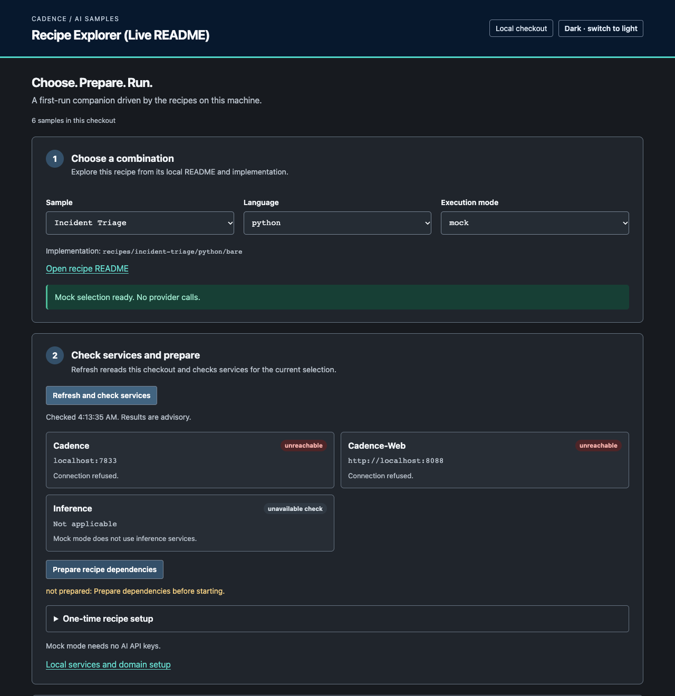

# Build Durable AI Agent Examples

Join Diana Zawadzki, Shijie Sheng and Cadence maintainers at KubeCon +
CloudNativeCon North America 2026.

- **When:** Wednesday, November 11, 2:20 to 3:40 PM MST
- **Where:** Salt Palace, Level 2, room 255 D, Salt Lake City

## Choose your contribution

- **Bring your own agent idea:** [open a recipe proposal and choose a recovery
  goal](shortlist.md#bring-your-own-workflow). Build something useful to you,
  then demonstrate what survives a failure.
- **Improve an existing example:** [choose a prepared task](shortlist.md#choose-your-level)
  and request a claim on its issue. Do not duplicate the issue.

You can propose a research assistant, coding agent, travel planner or another
agentic use case. Pick one small recovery scenario and use public or synthetic
data so others can reproduce it.

## New to Cadence? Start here

1. [Set up your local checkout](setup.md#first-time-here-start-with-your-selected-task).
2. [Choose a task by interest and difficulty](shortlist.md#choose-your-level).
3. Read the issue's scenario and contribution goal. Try its starting check,
   request the claim, make the change and compare the result with its success
   criteria. The issue links back here if you need to find your way again.

A **Workflow** records how a job progresses. An **Activity** is a step that
does work such as calling a model, reading logs or saving a report. A
**Signal** delivers input to a running Workflow, such as a review decision.
The examples let you change one behavior and inspect the result. You do not
need to learn every Cadence feature before choosing a focused task.

Each issue follows a short learning path: **What you will learn**, **Before
you start**, **Understand the problem**, **Your contribution**, **Check your
work**, and **Ready to hand off**. Pick the topic you want to learn, then
check the language and services it needs. Difficulty and setup requirements
are separate: a small test change may still require a language toolchain.

## Try the Samples Explorer

Start with the [Samples Explorer](../../tools/explorer/README.md) to choose
an agent recipe, prepare its dependencies and follow a Run in Cadence Web.
It reads your local code, including your edits, and gives you matching Worker
and Workflow commands.



*Browse first, then start the services your recipe needs. Here the checks show
that Cadence and Cadence Web are not running.*

From the repository root:

```bash
./scripts/explore.sh
```

You can browse with Python 3.10+ and venv support, before installing Cadence or
a model. The first launch downloads a Python dependency. See
[setup](setup.md#explore-the-samples-in-your-browser) for requirements.

Use it to:

- **Choose an example.** Select a recipe, language, framework and mock or live
  mode. The Explorer generates commands for that implementation.
- **Prepare and check your setup.** Install the recipe's dependencies with
  **Prepare recipe dependencies**, then use **Refresh and check services**.
  For a local live model, **Warm up selected local services** checks a small
  request before you start the Workflow.
- **Run your code.** Copy the Worker and Workflow commands into separate
  terminals. On macOS, **Open in Terminal** pastes a command for you to review
  and run.
- **Follow a Run.** Use **Resolve latest run**, then **Open history** or
  **Open queries** to inspect it in Cadence Web.
- **Send review input.** Recipes with Signal controls let you send guidance,
  request a revision or approve a result. Check the Run's state afterward to
  see how it handled your input.

For a first try, choose **Incident Triage**, **python**, **mock** (this recipe
has no framework selector) and follow
the [recipe runbook](../../recipes/incident-triage/README.md). Mock mode uses
scripted responses and needs no model or API key. Running the Workflow still
needs Cadence; the Run links need Cadence Web. The Explorer prepares recipe
dependencies, but you start the services, Worker and Workflow yourself.

## What you'll do

**Bring your own workflow and make it durable.** Bring an agent or script you
already run that makes at least one model or tool call. By the end, it runs
as a Cadence Workflow and survives the failure you're most worried about.

**1. Warm up together (about 20 minutes).** Incident Triage is an AI agent
investigating a fictional checkout outage with a real local model.

- **See it fail:** a log lookup gets an HTTP 429 rate limit, and with no retry
  policy the agent stops before it starts reasoning.
- **First win:** you add a [Cadence Activity retry policy](https://cadenceworkflow.io/docs/python-client/retries/), in one file. Run it
  again: the lookup waits, retries and the agent carries on. No retry loop in
  your code.
- **Handle a permanent failure:** in this exercise, a 404 is non-retryable, so retrying it only
  wastes time. Your policy must stop it after one attempt. Check both outcomes
  in Cadence Web.

Instructions:
[retry-policy exercise](../../recipes/incident-triage/python/bare/exercises/retry_policy_live/README.md).

**2. Make your own workflow durable (the rest of the session).**

1. Wrap: run your agent inside one [Activity](https://cadenceworkflow.io/docs/concepts/activities/), started by a [Workflow](https://cadenceworkflow.io/docs/concepts/workflows/).
   Every run, input, result and retry shows up in Cadence Web.
2. Split: move the model call and each tool call into their own Activities,
   so each one retries on its own and finished work isn't redone.
3. Steer (stretch): add a [Signal](https://cadenceworkflow.io/docs/python-client/signals/) so a person can approve or redirect.

Start from [#118](https://github.com/cadence-workflow/cadence-ai-samples/issues/118)
and [propose your example](shortlist.md#bring-your-own-workflow). Ask a
facilitator to review it and record your claim before upstream implementation.
Keep progress and unfinished next steps on that issue. Stop at any depth.

**Want to explore first?** [#119](https://github.com/cadence-workflow/cadence-ai-samples/issues/119): break a running agent on purpose
(stop the worker, send a Signal mid-run) and file what surprised you.

**Looking for a task?** Browse the [full issue pool](#issue-pool) in Get started,
then check the [approved tasks and claim steps](shortlist.md#contribfest-issues).
A facilitator records your claim before you start.

A merged fix, a draft pull request or a written next step are all good
outcomes. You can work by hand or with a coding agent. If you use an agent,
start it with the repository's [agent instructions](../../AGENTS.md).

<a id="get-ready"></a>

## Get started

- [Set up your laptop](setup.md).
- **Join `#cadence-contributors` on CNCF Slack.** [Sign up or sign in](https://slack.cncf.io/),
  then search for `#cadence-contributors` and join the channel. Ask setup,
  task and review questions there, and stay in touch after the session.
- [Find something to work on](shortlist.md).
- [See the session outline](agenda.md).

Ask a maintainer if you get stuck or want help choosing a task. The
[participant guide](../../CONTRIBFEST.md) covers claiming Issues, sign-off and
review.

### Issue pool

Use the [contribution shortlist](shortlist.md) to reach the official live
GitHub pool, browse prepared ideas or propose your own workflow. GitHub owns
current availability and claims; the shortlist is a starting snapshot.
